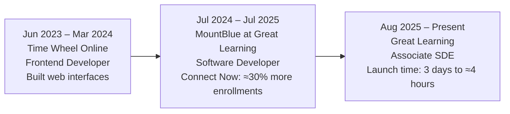

# Hi, I'm Umang Sahu

I'm a full-stack software developer based in Bengaluru. At Great Learning, I build tools that help teams launch programs and update their websites. My current focus is backend development with Java and Spring Boot.

[LinkedIn](https://linkedin.com/in/umangsahu)

## Work experience

## Projects

- **[Product Service](https://github.com/umangsahu/product-service)** — Spring Boot REST API for products and categories, backed by MySQL and Spring Data JPA.
- **Financial Analyst Manager** — A work-in-progress tool for Indian equities. Spring Boot handles the core application and market data. FastAPI handles valuation, anomaly detection, and financial filing summaries.

## Tech stack

- **Backend** — Java, Spring Boot, Node.js, Python, FastAPI
- **Frontend** — JavaScript, TypeScript, React, Next.js
- **Data and tooling** — PostgreSQL, MySQL, MongoDB, Docker, GitHub Actions, AWS
